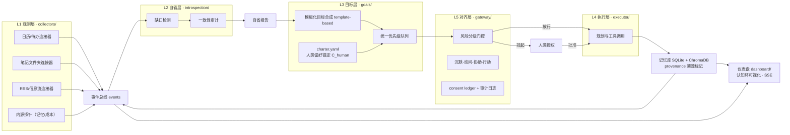

# 主动式 AI 助理（Proactive AI Assistant）

> 一个**诚实定位**的个人开源项目：以理论论文《主动式AGI的理论框架与落地约束》为依据，构建 FL-PCL 五层持续认知闭环的**受限常驻实例（restricted-persistence instance）**，并把它当作**实证仪器**——测量"模拟的主动性"在个人尺度上的真实表现。

**当前状态：P1–P5 已完成 + 安卓 APK 客户端（论文 + 调研 + 观测 + 自省/目标 + 对齐门控 + Liquid Glass 仪表盘 + Kotlin/Compose 手机端）。54 个后端测试全绿。**

---

## 这是什么 / 这不是什么

论文第 2.4 节给出了可证伪判据：**外观上的主动行为不构成范式判据，目标来源的结构才是**。本项目按论文自己的结论行事——

| | 本项目**是** | 本项目**不是** |
|---|---|---|
| 架构 | FL-PCL 五层闭环的工程实例（观测→自省→目标→执行→对齐） | 主动式 AGI 的实现（论文第 5 章已论证：C 级模块当前不可实现） |
| 定位 | 论文处方的"受限常驻系统 + 实证仪器"（论文 5.2 结论三） | "接近 AGI 的通用智能体"这类不可证伪的宣称 |
| 目标层 | **模板化目标合成**，源码与文档中明确标注 `template-based` | 伪装成"无模板目标内生"的演示 |
| 自省层 | 周期性子省 + 缺口报告，B 级模块，明确标注"主动行为的模拟" | 声称可靠的元认知 |
| 数据 | **本地优先**：单用户（作者本人），数据不出本机，全量授权与审计留痕 | "无感收集"——本仓库在任何文档与代码中不使用该表述 |
| 自主性 | 内生目标限定只读型认知行为；一切外部行为经人类授权（论文 P5 硬约束） | 无人值守的自主执行 |

这个"不是什么"清单不是谦辞，而是本项目的核心设计约束：**论文给出的判别准则，本项目用工程和实验自我执行**（见 OQ7 模板移除测试，P6 阶段）。

## 理论来源

论文全文见 [`paper/proactive-agi-theory.md`](paper/proactive-agi-theory.md)（GitHub 直接渲染）或 [`paper/proactive-agi-theory.tex`](paper/proactive-agi-theory.tex)（投稿级 LaTeX，Overleaf 一键导入编译 PDF）。论文提出：

- **三范式判据**：被动应答式 AI / 任务驱动型自主 Agent / 主动式 AGI（P1 常驻、P2 持续观测、P3 内部自省、P4 目标内生、P5 可控对齐，五条件联立）；
- **FL-PCL 五层架构**：环境持续观测层 → 内部认知自省层 → 自主目标内生层 → 任务规划与执行层 → 人机可控安全对齐层；
- **五大理论困境**：目标漂移、自省不可靠、记忆腐化、算力边界、无人值守对齐；
- **七条开放研究问题（OQ1–OQ7）**，其中 OQ5（认知周期剂量—效应曲线）与 OQ7（真实/模拟主动性的可判定区分）为本项目的实证入口。

## 市面调研：2026 主动式 AI 助理全景

市场已进入"主动式 AI 助理"的产品化元年——智能体手机（STEPX Neo、努比亚豆包手机二代）、系统级助手（华为小艺、三星 Bixby、OPPO 小布 Next、Apple Siri AI）、云端记忆重写（ChatGPT Dreaming V3、Claude/Gemini/Grok/Copilot 记忆）、第三方记忆层（MemoryLake、Hatch）全线爆发。 [`docs/RESEARCH-2026-landscape.md`](docs/RESEARCH-2026-landscape.md) 用论文 P1–P5 判据对代表产品逐一体检，结论：

1. **全部产品均不满足 P4（目标内生）**——它们的"主动"是对时间/地点/习惯等外部信号的预判式服务，论文 2.4 节称之为"主动行为的模拟"，2026 年的产品把这种模拟做到了消费级完成度；
2. 市场印证了论文两个判断：竞争全部集中在执行端（场景数/生态/跨 App），评价端无人作为卖点（5.2 结论二）；责任不可保的自主不被允许——ChatGPT Dreaming 在欧盟被 GDPR 封锁（5.4.4 的字面执行）；
3. **空缺即生态位**："主动性的计量基准"无任何厂商提供，这正是本项目的实证入口（OQ5/OQ7）。

## 架构：FL-PCL 五层 → 工程模块映射



设计原则直接来自论文 3.0：闭环优先于流水线（常驻由无终止迭代实现）；内生/外生目标并轨入同一队列；对齐层是横切门控而非末端审查。

## 路线图（每阶段开工前经维护者确认，固定收尾=验证清单+ADR+devlog）

| 阶段 | 内容 | 状态 |
|---|---|---|
| P0 | 定位冻结：技术选型、数据边界、对外表述 | ✅ 已完成 |
| P1 | 工程骨架 + 论文资产化 + 市面调研（仓库结构、README、LaTeX、ADRs、2026 竞品体检） | ✅ 已完成 |
| P2 | 观测层：本地授权连接器、事件抽取管道、SQLite 事件库、审计日志、REST+SSE API | ✅ 已完成（20 测试全绿、幂等回放验证） |
| P3 | 自省层 + 目标层：周期自省、模板化目标合成、`charter.yaml` 锚定文件 | ✅ 已完成（30 测试全绿、目标队列幂等） |
| P4 | 对齐层 + 提醒引擎：风险三级门控、沉默-询问-协助-行动四态、批量审计 | ✅ 已完成（47 测试全绿、四态实测） |
| P5 | 仪表盘：认知环可视化、charter 编辑器、提醒队列、成本面板 | ✅ 已完成（浏览器实测四联截图） |
| P6 | 实验与度量：OQ7 模板移除测试、OQ5 周期率剂量效应、记忆健康指标（14 天个人运行） | ⬜ |
| P7 | 作品集化：实证论文草稿、demo 视频 | ⬜ |

详细设计见 [`docs/ROADMAP.md`](docs/ROADMAP.md)；架构决策记录见 [`docs/adr/`](docs/adr/)。

## 仓库结构

```
proactive-ai-assistant/
├── README.md                  # 本文件
├── LICENSE                    # MIT（代码）
├── paper/                     # 理论论文（CC BY 4.0）
│   ├── proactive-agi-theory.md    # 权威源，GitHub 直接渲染
│   ├── proactive-agi-theory.tex   # 由 md2tex.py 生成的投稿级源码
│   ├── md2tex.py                  # Markdown → LaTeX 转换器（可复现）
│   └── README.md                  # 编译与引用说明
├── docs/
│   ├── ARCHITECTURE.md        # 五层架构工程设计
│   ├── ROADMAP.md             # P0–P7 详细路线图
│   ├── RESEARCH-2026-landscape.md  # 市面调研：竞品全景与 P1–P5 判据体检
│   ├── charter.example.yaml   # C_human 偏好锚定文件示例
│   ├── adr/                   # 架构决策记录
│   └── devlog/                # 开发日志（全程记录）
├── assistant/                 # 主程序（P2–P4 已可运行）
│   ├── assistant/             # 主包
│   │   ├── collectors/        # 三个本地授权连接器 + runner
│   │   ├── extraction/        # rules（默认）/ mock_llm 抽取器
│   │   ├── memory/            # SQLite 仓储 + 向量存储抽象
│   │   ├── events/            # 事件总线（SSE 消费）
│   │   ├── introspection/     # 缺口检测 + 自省报告 [B-simulated]
│   │   ├── goals/             # 模板化目标合成 + 优先级队列
│   │   ├── gateway/           # 四态门控 + 提醒引擎
│   │   ├── charter.py         # C_human 偏好锚定加载
│   │   └── api/               # FastAPI：REST + SSE + 健康检查（+API Key 鉴权）
│   ├── migrations/            # SQLite 迁移（含回滚段）
│   ├── fixtures/              # 种子数据（ics + 笔记 + rss，零配置可跑）
│   ├── scripts/               # seed / deep_cycle / reminder_cycle CLI
│   └── tests/                 # 54 个测试
├── dashboard/                 # 仪表盘（P5：Vite + React + TS，Liquid Glass）
│   └── src/views/             # 认知环 / 事件流 / 自省 / 目标 / 提醒门控 / Charter / 成本
├── android/                   # 安卓 APK 客户端（Kotlin + Compose，APIKEY 即用）
│   └── README.md              # 架构 / 构建 / 使用说明
├── experiments/               # OQ5/OQ7 实验脚本（P6 起）
└── data/                      # 本地运行时数据（gitignored）
```

## 快速开始（观测层）

```bash
cd assistant
pip install -r requirements.txt          # 或 pip install -e ".[dev]"

# 方式一：种子回放（零配置，演示数据）
python -m scripts.seed --reset           # 第一次：16 事件入库
python -m scripts.seed                  # 第二次：inserted 全 0（幂等验证）

# 方式二：起服务（同样零配置，自动挂载 fixtures 演示连接器）
uvicorn assistant.api.app:create_app --factory --host 127.0.0.1 --port 8787
# 打开 http://127.0.0.1:8787/docs 交互式 API 文档
# curl -X POST http://127.0.0.1:8787/api/v1/collectors/run   # 手动触发一次轻观测周期
# curl -N http://127.0.0.1:8787/api/v1/stream                # SSE 实时事件流

# 方式三：跑一次深周期（自省 → 目标合成，论文 3.2→3.3）
python -m scripts.run_deep_cycle
# curl -X POST http://127.0.0.1:8787/api/v1/introspection/run  # API 触发深周期
# curl http://127.0.0.1:8787/api/v1/goals                      # 查看目标队列

# 方式四：跑一次提醒周期（四态门控，论文 3.5）
python -m scripts.run_reminder_cycle
# curl -X POST http://127.0.0.1:8787/api/v1/reminders/run     # 触发提醒周期
# curl http://127.0.0.1:8787/api/v1/reminders                 # 干预台账（含被沉默的）
# curl http://127.0.0.1:8787/api/v1/gateway/stats             # 决策分布+授权疲劳自检

# 方式五：仪表盘（P5，Liquid Glass）
cd ../dashboard && npm install && npm run dev      # http://localhost:5173

# 方式六：安卓 APK（Kotlin + Compose，APIKEY 即用）
# 电脑端：.env 设 API_KEY=你的密钥，然后
uvicorn assistant.api.app:create_app --factory --host 0.0.0.0 --port 8787
# 手机端：GitHub Actions 自动构建 APK（仓库 Actions → android workflow → Artifacts），
# 或本地 gradle assembleDebug；安装后填后端地址（电脑局域网 IP）+ API Key。
# 详见 android/README.md
```

接入自己的数据：复制 `.env.example` 为 `.env`，设置 `COLLECTOR_ICS_PATHS` / `COLLECTOR_NOTES_PATHS` / `COLLECTOR_RSS_URLS` 后重启。

论文阅读：直接打开 [`paper/proactive-agi-theory.md`](paper/proactive-agi-theory.md)；或将其 `.tex` 导入 [Overleaf](https://www.overleaf.com)（XeLaTeX）编译 PDF。

## 设计决策速览

完整论证见 ADR，要点：

1. **诚实定位**（[ADR-0003](docs/adr/0003-honest-positioning.md)）：B 级模块标注"模拟主动性"，用论文 5.2 判别准则自我检验；
2. **授权持续感知**（[ADR-0004](docs/adr/0004-authorized-sensing.md)）：consent ledger 授权账本 + 全量审计日志 + 本地优先，数据不出本机；
3. **常驻成本控制**（[ADR-0005](docs/adr/0005-resident-cost-control.md)）：低频深周期（1–2 次/天）+ 高频轻观测（本地规则，不调 LLM）+ MockLLM 无密钥可复现；
4. **技术栈**（[ADR-0002](docs/adr/0002-tech-stack.md)）：FastAPI + SQLite/ChromaDB + React/TS + SSE，本地单用户；
5. **观测层工程决策**（[ADR-0006](docs/adr/0006-p2-observation-decisions.md)）：确定性 event_id 幂等、线程局部连接、fixtures 自动挂载、rules 抽取器默认。

## License

代码 MIT；论文及文档 CC BY 4.0（署名即可使用，欢迎引用与批评）。
